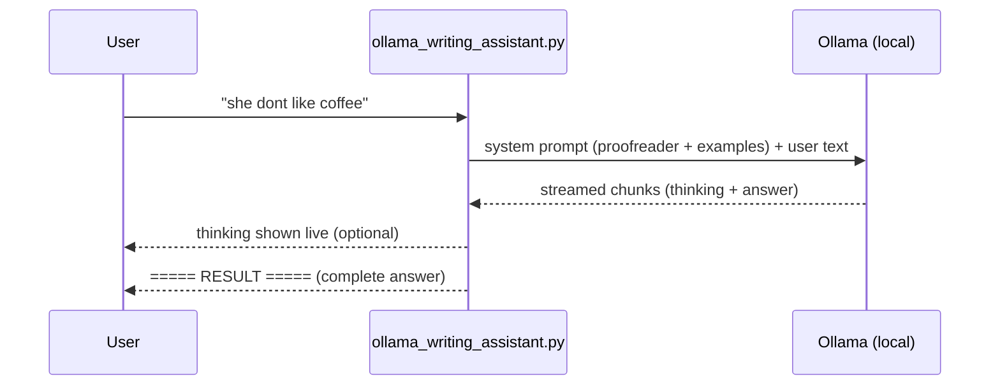

# Ollama Writing Assistant: AI Email Drafting & English Grammar Correction

**A private, offline AI writing assistant that drafts professional emails and corrects English grammar, built with plain Ollama in a single Python file.**

[](https://github.com/rizwannazir333/ollama-writing-assistant/actions/workflows/ci.yml)


-6E40C9)


> **Series: Building the same AI app three ways**
> **Part 1: Plain Ollama** (this repo) · [Part 2: LangChain](https://github.com/rizwannazir333/langchain-writing-assistant) · [Part 3: LangGraph](https://github.com/rizwannazir333/langgraph-writing-assistant)

---

## Overview

I built this project to answer a question many students and developers ask: *what is the minimum code
needed to build a useful AI application that runs entirely on your own machine?*

The answer is about 140 lines of Python. This repository contains a command-line assistant that
performs two everyday tasks:

- **Email drafting:** turns a one-line request into a polite, professional email.
- **English correction:** fixes grammar, spelling and tense, and explains every change.

It talks directly to a locally running language model through the official `ollama` Python library,
with **no framework, no cloud service and no API key**. Your text never leaves your computer.

This is **Part 1** of a three-part series. Parts 2 and 3 rebuild the same application with
**LangChain** and **LangGraph**, so the three repositories can be compared side by side to see exactly
what each framework adds.

---

## Key Features

- **100% local and private:** runs on Ollama, works offline, no data sent to third parties.
- **Email guardrail:** removes promises the model invents (e.g. *"I will ensure my tasks are completed"*).
- **CPU-friendly:** uses a 4-bit quantized 4B model (`qwen3.5:4b`, Q4_K_M) that runs on an ordinary laptop with no GPU.
- **Two tasks, one function:** both tasks share the same request logic; only the system prompt changes.
- **Few-shot prompting:** worked examples inside the prompt make a small model noticeably more accurate.
- **Optional live reasoning:** with `--think`, the model's thinking streams live, and the final answer is printed in one piece.
- **Fast by default:** small context window, capped output, model pre-loaded and kept in memory.
- **Automatic model selection:** uses the first model you have installed from a preferred list.
- **Interactive menu and one-line CLI:** use it conversationally or from scripts.

---

## How It Works



1. The user picks a task and enters text.
2. The script builds a **system message** (the model's role and rules) and a **user message** (the input).
3. `ollama.chat(..., stream=True)` sends both to the local model.
4. Thinking tokens, if enabled, are printed as they arrive; answer tokens are collected silently.
5. When generation finishes, the complete answer is printed at once, with the time taken.

---

## Tech Stack

| Component | Choice | Why |
|---|---|---|
| Model runtime | [Ollama](https://ollama.com) | One-command install, runs models locally on CPU or GPU |
| Model | `qwen3.5:4b` (Q4_K_M, 3.3 GB) | Best accuracy/speed balance on CPU in my tests; supports thinking |
| Client library | `ollama` (Python) | Official, minimal, no abstraction layers |
| Language | Python 3.10+ | Standard library only, besides `ollama` |

---

## Getting Started

### Prerequisites

- Python **3.10+**
- [Ollama](https://ollama.com/download) installed and running
- **8 GB RAM** minimum (16 GB recommended); **no GPU required**
- ~4 GB free disk space

### Installation

```bash
# 1. Download the model (one time, ~3.3 GB)
ollama pull qwen3.5:4b

# 2. Clone the repository
git clone https://github.com/rizwannazir333/ollama-writing-assistant.git
cd ollama-writing-assistant

# 3. Create a virtual environment and install the dependency
python -m venv .venv
# Windows
.venv\Scripts\python -m pip install -r requirements.txt
# macOS / Linux
.venv/bin/python -m pip install -r requirements.txt
```

> The script detects a `.venv` folder next to it and re-launches itself with that interpreter, so
> `python ollama_writing_assistant.py` works even without activating the environment.

---

## Usage

### Interactive menu

```bash
python ollama_writing_assistant.py
```

```
[plain ollama | model: qwen3.5:4b | thinking: off]

1) Draft email   2) Correct English   q) Quit
> 2
Text to correct:
> they was going to the shop and buyed some bread

===== RESULT =====
Corrected: They were going to the shop and bought some bread.
Changes:
- they -> They (capitalization for sentence start)
- was -> were (plural subject agreement)
- buyed -> bought (irregular past tense)
(21s)
```

### One-line commands

```bash
python ollama_writing_assistant.py email "ask my manager for Friday off for a family event"
python ollama_writing_assistant.py correct "me and him is going to meeting tomorow"
python ollama_writing_assistant.py --think correct "me and him is late"     # show reasoning
python ollama_writing_assistant.py -m llama3.2:3b correct "..."             # choose a model
```

### Options

| Option | Description |
|---|---|
| `email TEXT` / `correct TEXT` | Run one task and exit (no menu) |
| `--think` | Stream the model's reasoning live before the result (more accurate, much slower on CPU) |
| `-m MODEL` | Use a specific Ollama model |

If no model is given, the first installed model from this list is used:
`qwen3.5:4b` → `llama3.2:3b` → `qwen2.5:3b` → `qwen3.5:latest`.

---

## Code Walkthrough

The whole application lives in [`ollama_writing_assistant.py`](ollama_writing_assistant.py).

**1. Prompts define behaviour.** Each task is just a different system prompt:

```python
EMAIL_PROMPT   = "You write short, polite, professional emails. ..."
CORRECT_PROMPT = "You are a careful English proofreader. ... Example for 'She goed to the market.': ..."
```

**2. One request function for every task:**

```python
stream = ollama.chat(
    model=model,
    messages=[{"role": "system", "content": system},
              {"role": "user", "content": text}],
    think=think,
    options={"temperature": 0.3, "num_ctx": 4096 if think else 2048,
             "num_predict": 2500 if think else 500},
    stream=True,
    keep_alive="30m",
)
```

**3. Separate reasoning from the answer while streaming:**

```python
for chunk in stream:
    thought = chunk.message.thinking or ""
    if thought:
        print(thought, end="", flush=True)        # reasoning: shown live
    answer += chunk.message.content or ""         # answer: collected
print(f"===== RESULT =====\n{answer.strip()}")    # answer: printed once
```

---

## Performance

Measured on a laptop with an **Intel Core i7-1165G7, 16 GB RAM, no GPU**, Windows 11:

| Task | Model | Thinking | Time |
|---|---|---|---|
| Correct one sentence | `qwen3.5:4b` | off | **11–22 s** |
| Draft an email | `qwen3.5:4b` | off | **~20 s** |
| Correct one sentence | `llama3.2:3b` | off | 5–25 s (less accurate) |
| Correct one sentence | `qwen3.5:4b` | on | several minutes |

---

## Design Decisions

- **A plain-Python guardrail for emails:** small models like to add promises nobody asked for
  (*"I will ensure my tasks are completed"*). `remove_unrequested_promises()` deletes those
  sentences unless the request itself mentions them: instant, predictable and free, with no
  extra model call.
- **Why a 4B quantized model?** In my comparison, `qwen3.5:4b` corrected *"me and him is going"* to
  *"He and I are going"*, which smaller 3B models got wrong, while staying fast on a CPU.
- **Why is thinking off by default?** On a CPU, reasoning can add minutes per answer. It is available
  on demand with `--think`.
- **Why print the answer at once instead of streaming it?** The result is easier to read and copy as a
  complete block, while streaming the reasoning still shows that the model is working.
- **Why no framework?** To make every step visible. This file is the baseline the LangChain and
  LangGraph versions are measured against.

---

## Limitations

- Small models can still make mistakes. The guardrail removes the most common one (invented
  promises), but **always review an AI-written email before sending it.**
- The answer format is plain text, so other programs can't easily consume it.
  (Part 2 solves this with structured output.)
- No memory between requests, and no tool use (e.g. it can't look up today's date).

---

## Extend It

Ideas for learners who want to build on this project:

1. Add a **"Summarise text"** task with its own system prompt.
2. Add more few-shot examples (e.g. *"I has two cat."* → *"I have two cats."*) and measure the effect.
3. Experiment with `temperature` (0.0 vs 1.0) and compare outputs.
4. Benchmark different models on the same 10 sentences for speed and accuracy.

---

## Troubleshooting

| Problem | Solution |
|---|---|
| `model "qwen3.5:4b" not found` | Run `ollama pull qwen3.5:4b` |
| `Connection refused` | Start the Ollama app, or run `ollama serve` |
| `ModuleNotFoundError: No module named 'ollama'` | Complete the installation step |
| Menu appears unresponsive | Enter the option number first (`1` or `2`), then your text |
| Very slow responses | Avoid `--think`, close heavy applications, run one model at a time (`ollama ps`) |

---

## Project Structure

```
ollama-writing-assistant/
├── ollama_writing_assistant.py     # the application
├── requirements.txt            # pinned dependency
├── .gitignore                  # keeps .venv and caches out of Git
├── LICENSE                     # MIT License
└── README.md                   # this document
```

---

## Continue the Series

| Part | Repository | What it adds |
|---|---|---|
| **1** | **ollama-writing-assistant** (you are here) | Direct model access, prompting, streaming |
| 2 | [langchain-writing-assistant](https://github.com/rizwannazir333/langchain-writing-assistant) | Prompt templates, chains, structured output, memory, tools, agents |
| 3 | [langgraph-writing-assistant](https://github.com/rizwannazir333/langgraph-writing-assistant) | Graph workflows, self-review loops, human approval, parallelism, caching |

---

## License

Released under the [MIT License](LICENSE). You are free to use, modify and share this
project, including in your own courses and classrooms, as long as the copyright notice is kept.

---

## Author

Created and maintained by **[@rizwannazir333](https://github.com/rizwannazir333)**.

If this project helped you learn, please consider giving it a ⭐. Questions, suggestions and
improvements are welcome through [Issues](https://github.com/rizwannazir333/ollama-writing-assistant/issues).
